# Engineering Portfolio: Mike Miller

Hardware Design Engineer focused on wearable sensor integration and PCB design. This page documents the R&D process, design methodology, and troubleshooting logs for my current hardware projects.

---

## 🛠 Skills & Competencies
* **PCB Design:** KiCad, Altium Designer (Schematic Capture, Layout, DFM)
* **Embedded Systems:** nRF5340, STM32WB, BLE Firmware integration
* **Analog/Mixed Signal:** ECG/EMG AFE designs, Audio/Optical systems
* **Mechanical Design:** SOLIDWORKS, 3D printing

---

## 🚀 Featured Projects
### 1. Forehead EEG device for tracking focus and stress throughout the day.
*First version of a device for monitoring day-to-day activity to become aware of triggers of stress and gaps in focus to attempt to make myself more efficient*

#### Overview
- **Objective:** Design a wireless EEG to enable any user to access focus trends.
- **Key Components:** TI ADS1299, nRF5340 MDBT53V-1M SOC, USB, rechargeable Li-Ion battery, nickel-free gold electrodes.

#### Engineering Process
- **Design Philosophy:** Focus on electrode placement to optimize skin coupling and signal acquisition. Additional processing can be done via DSP rather than hardware.
<table>
<tr>
<td width="50%">
  <a href="assets/AX_EMG_REV1_2D.png">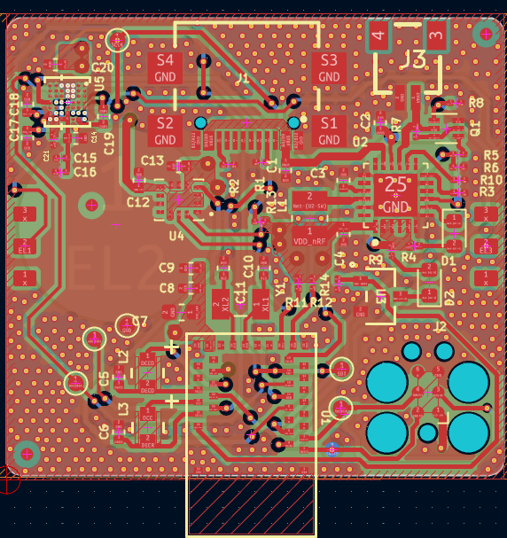</a> 
  4-layer layout, 25 × 40 mm — top copper and silkscreen.
</td>
<td width="50%">
  <a href="assets/AX_EMG_ARM_FAB.png">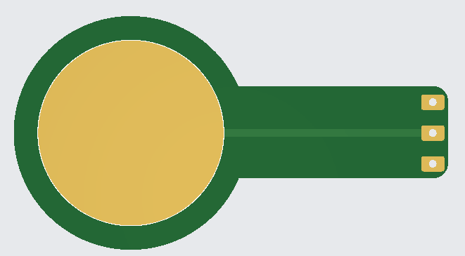</a> 
  Flex electrode arm — nickel-free gold skin pad.
</td>
</tr>
<tr>
<td width="50%">
  <a href="assets/AX_EMG_REV1_FAB_TOP.png">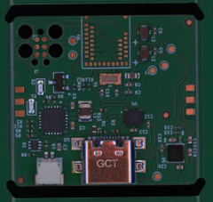</a> 
  Fabricated board, top — MAX86178 AFE, nRF5340 module, USB-C charging.
</td>
<td width="50%">
  <a href="assets/AX_EMG_REV1_FAB_BOTTOM.png">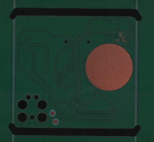</a> 
  Fabricated board, bottom — electrode pad and battery contacts.
</td>
</tr>
</table>

- **Debug Log / Lessons Learned:**
    - **Issue:** None yet, undergoing final stages of design review prior to manufacturing.
    - **Future Iteration:** A more desirable and discreet location, maybe behind the head or ear.  

#### Status
- **Current Phase:** Undergoing final stages of design. A companion iOS app is in development in parallel.

### 2. Wearable EMG sticker for wireless performance tracking and muscle asymmetry
*Redesign of previous wearable design for a more flexible form factor across muscle groups*

#### Overview
- **Objective:** Design a wireless EMG sticker to enable any user to access physical activity data.
- **Key Components:** ADI MAX86178, nRF5340 MDBT53V-1M SOC, USB, rechargeable Li-Ion battery, nickel-free gold electrodes.

#### Engineering Process
- **Design Philosophy:** Focus on a flexible "sticker" design to easily place on any muscle belly for improved performance tracking and muscle asymmetry detection on opposite limbs.
<table>
<tr>
<td width="50%">
   
  4-layer layout, 25 × 40 mm — top copper and silkscreen.
</td>
<td width="50%">
   
  Flex electrode arm — nickel-free gold skin pad.
</td>
</tr>
<tr>
<td width="50%">
   
  Fabricated board, top — MAX86178 AFE, nRF5340 module, USB-C charging.
</td>
<td width="50%">
   
  Fabricated board, bottom — electrode pad and battery contacts.
</td>
</tr>
</table>

- **Debug Log / Lessons Learned:**
    - **Issue:** AFE component fails to communicate over SPI. 
    - **Root Cause:** 0.15mm vias underneath a fragile BGA component were wicking solder away from the component, preventing continuity. Attempted to replace the component with no luck. 
    - **Resolution:** Tented vias to prevent solder wicking into holes. 
    - **Future Iteration:** Considering not using an expensive and sensitive AFE chip and designing my own AFE instead. 

#### Status
- **Current Phase:** In freeze. Lessons learned from this revision have been logged and are being carried into newer designs.

### 3. Wearable 2-channel EMG with gyroscope & buzzer for real-time bio-feedback
*An initial prototype of a neural-feedback system for reading movement/muscle data and notifying the user of biomechanical events*

#### Overview
- **Objective:** Design a wireless, multi-channel EMG to enable any user to access every-day movement patterns.
- **Key Components:** nRF5340 MDBT53-1M SOC, USB, rechargeable Li-Ion battery.

#### Engineering Process
- **Design Philosophy:** Focus on design validation to improve the form factor in later iterations.
                  [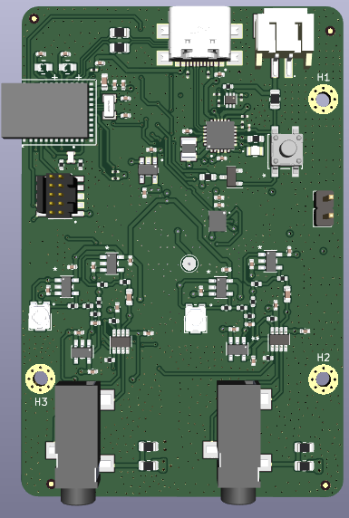](assets/2-channel_EMG_V1.png)
                  [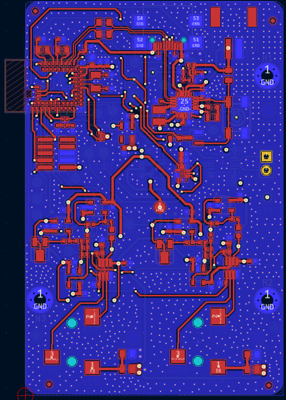](assets/Fidget_Layout.png)
- **Debug Log / Lessons Learned:**
    - **Issue:** Button is not readable.
    - **Root Cause:** Self-assembly at hot-air bench was not sufficient for making electrical contact between the nRF5240 Module and the related button detection GPIO.
    - **Resolution:** Solder reflow with hot plate and hot air created the proper reflow profile at the module GPIO pin. The system became fully functional.
    - **Future Iteration:** Significantly reduce form factor to fit in mechanical housing and support adhesion to various body locations. WIrelessly connect to applications.

#### Status
- **Current Phase:** Design verified to be fully functional. This board is now being used to develop iOS apps for other designs using the same nRF architectures.

### 4. FFT-Based LED Strip Controller
*A compact, wall outlet compatible device for creating dynamic, color changing LED's that travel across the entire length of an LED Strip.*

#### Overview
- **Objective:** Design an audio based system for reading audio signals, deriving the base frequencies, and changing the color of LEDs on the strip.
- **Key Components:** nRF5340 MDBT53-1M SOC, analog front end, buck converter, LDO.

#### Engineering Process
- **Design Philosophy:** Focused on filtering out sound for ease of signal processing and FFT analysis.
          [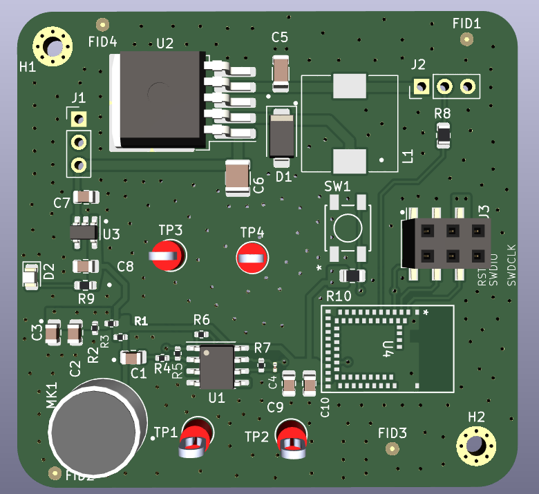](assets/LED1_TOP.png) [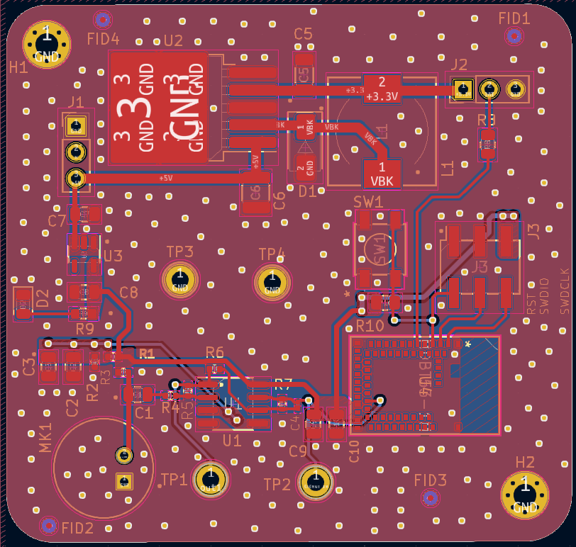](assets/LED_Layout.png)
- **Debug Log / Lessons Learned:**
    - **Issue:** Could detect target device when programming, but could not flash to the core.
    - **Root Cause:** Inadequate pad-to-pour clearance in the initial layout - short between GND and SWDCLK.
      [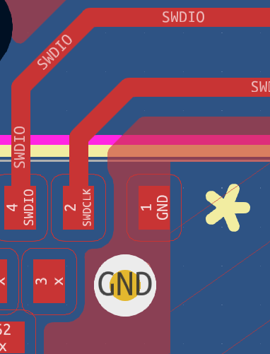](assets/LED1_short.png)
    - **Resolution:** Validated via continuity testing.
    - **Future Iteration:** Relocate GND via near SWDCLK on MDBT53-1M pads, reduce GND pour coverage near pads.

#### Status
- **Current Phase:** Power/digital architecture validated. AFE and firmware validated on breadboard for full LED control. Redesign to relocate via and pour profile.

### 5. Wireless EMG Wearable
*A compact, low-power wearable device for EMG signal acquisition.*

#### Overview
- **Objective:** Design a small-scale wearable EMG sensor node with integrated BLE for remote monitoring.
- **Key Components:** STM32 MCU, Custom Analog Front End (AFE), LiPo Battery.

#### Engineering Process
- **Design Philosophy:** Focused on miniaturization and high SNR for biosignals.
- **CAD/Layout:**  
                  [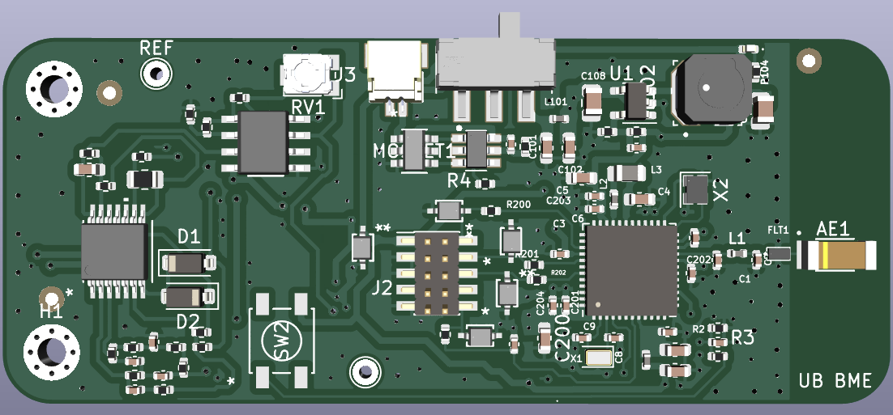](assets/EMG1_TOP.png)
                   
                  [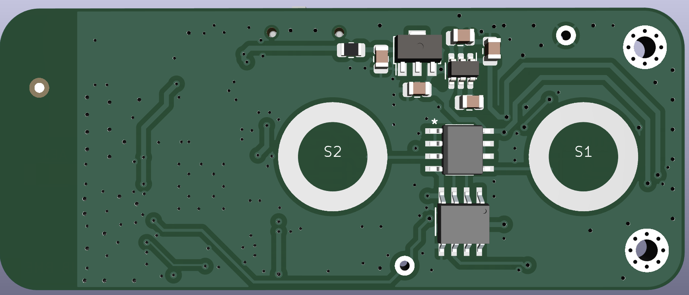](assets/EMG1_BOTTOM.png)
                   
                  [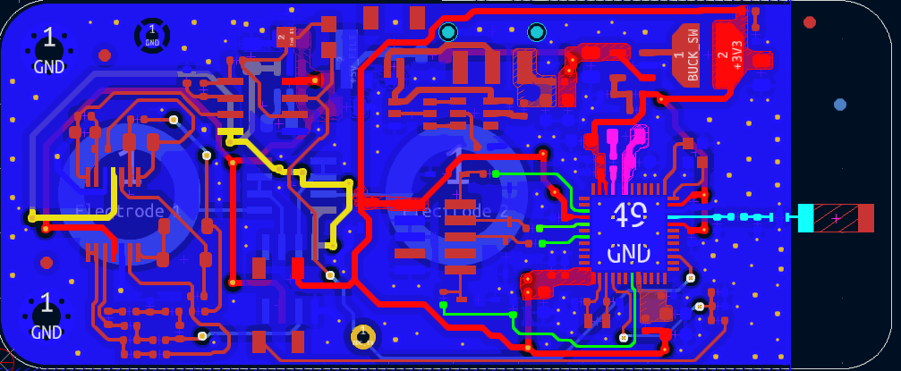](assets/EMG1_Layout.png)
- **Debug Log / Lessons Learned:**
    - **Issue:** Encountered configuration issues when setting up STM32WB through STM32CubeIDE.
    - **Root Cause:** Inadequate reflow on STM32 during assembly.
    - **Resolution:** Validated via continuity testing.
    - **Future Iteration:** Design around reflow, select another chip.

## 📧 Contact
- **LinkedIn:** www.linkedin.com/in/michael-miller-4b3918201
- **Email:** mmille7497@gmail.com
